# Labs64.IO :: Reporting

**Read-only reports over the events your AuditFlow sinks stored: each customer sees its own rows only.**
*Part of the [Labs64.IO Ecosystem](https://labs64.io): the read side of your audit trail, between your backend and your stores.*

[](https://github.com/Labs64/labs64.io-reporting/actions/workflows/labs64io-ci.yml)
[](https://hub.docker.com/r/labs64/reporting)
[](https://artifacthub.io/packages/helm/labs64io-helm-charts/reporting)
[](LICENSE)
[](https://labs64.io/docs/modules/reporting/)

<p align="center"></p>

[**Get started**](#try-it-in-two-minutes) · [Features](#features) · [Architecture](#architecture) · [Catalogue](#the-catalogue) · [AI agents](#using-it-with-ai-agents) · [Ecosystem](#the-labs64io-ecosystem) · [Documentation](https://labs64.io/docs/modules/reporting/) · [labs64.io](https://labs64.io)

> [!NOTE]
> Alpha. A tenant's backend calls this service on behalf of its customers; browsers and customers never reach it directly.

## Why Reporting?

AuditFlow routes events and owns no database, by design. Once the events sit in ClickHouse and S3, every product needs the same thing on top: show each customer its own numbers, safely. Handing customers SQL makes the schema a public contract at unbounded cost, and a new endpoint per chart never ends.

1. **A metric is a reviewed definition.** A catalogue names the table, the aggregation, the dimensions and the filters. Adding a metric adds a catalogue entry, not an endpoint.
2. **A request never becomes SQL.** It picks names from the catalogue, and every value is a bound parameter.
3. **Isolation is enforced twice.** Every query filters on the caller's scope, and a row policy on the server applies the same scope to a query that forgot.

**A good fit if**

- You already store events in ClickHouse, with or without AuditFlow, and several customers share a table.
- Your backend authenticates the customer and can say what its plan allows.

**Probably not what you need if**

- You want a BI tool for your own staff: Grafana or Athena on the same stores serves that better.
- You need dashboards, schedules or exports out of the box: this is the API under them.

## Try it in two minutes

Docker only. This starts the service next to a ClickHouse with a small demo tenant:

```bash
docker compose -f docker-compose.images.yml up -d --wait
```

There is no gateway here, so you send the headers one would set. Ask for the same metric as two customers:

```bash
report() {
  curl -s localhost:8080/metrics/query -H 'Content-Type: application/json' \
    -H 'X-Auth-User: service:demo' -H 'X-Auth-Tenant: demo' -H 'X-Auth-Scopes: reporting:read-delegated' \
    -H 'X-Request-ID: demo' -H "X-Reporting-Scope: $1" -H 'X-Reporting-Groups: base' \
    -d '{"metric":"calls","from":"2020-01-01T00:00:00Z","to":"2100-01-01T00:00:00Z","interval":"none"}'
}
report acme     # value 3
report globex   # value 1
```

**On Kubernetes:**

```bash
helm repo add labs64io https://labs64.github.io/labs64.io-helm-charts
helm install reporting labs64io/reporting
```

Mount your catalogues at `/etc/labs64/reporting/catalogue` (values `volumes`, `volumeMounts`) and put a reader's password in `secrets.data.CLICKHOUSE_PASSWORD`. The [chart README](https://github.com/Labs64/labs64.io-helm-charts/tree/master/charts/reporting) lists every value.

**From source** (JDK 25, Maven): `mvn -B verify`. The integration test starts a real ClickHouse and skips itself when no Docker runs.

## Features

- **Metric catalogue**: one YAML file per tenant, validated at start. An invalid file stops the rollout instead of serving wrong numbers.
- **Metrics API**: a series by range and interval, with up to two dimensions and filters.
- **Event list and traces**: events paged by cursor, newest first, and every event of one correlation ID.
- **Bodies from S3**: an event's archived request and response, fetched by a key computed from its row. Optional, and limited to a group you name.
- **Groups and history**: your backend translates a plan into `X-Reporting-Groups` and `X-Reporting-History-Days`. This service knows no plan names.
- **Bounded**: query limits sit on the ClickHouse user, and a store that does not answer gives a `503` with `Retry-After`.
- **OpenAPI-first**: the [contract](src/main/resources/openapi/openapi-reporting-v1.yaml) generates the server interfaces and the gateway policies.
- **Observable**: Actuator health, Prometheus metrics (`reporting.operation`, per operation and tenant, never per customer) and OTLP traces.

## Architecture

```text
 your backend ──POST + token + X-Reporting-Scope──▶ API Gateway ──▶ Reporting ──reader user + row policy──▶ ClickHouse
 (authenticates the customer,                       (token, scope)      │
  translates its plan)                                                  └──read only──▶ S3 (bodies)

 your services ──events──▶ AuditFlow ──▶ ClickHouse, S3
```

| Operation | Purpose |
|---|---|
| `POST /metrics/list` | The metrics this caller may see |
| `POST /metrics/query` | A series: range, interval, up to two dimensions, filters |
| `POST /events/search`, `/events/get` | Events, cursor paged; one event |
| `POST /traces/get` | Every event of one correlation ID |
| `POST /events/body` | An event's archived bodies |
| `POST /status` | How fresh the data is |

Every operation is `POST`, so it passes a public edge that only lets `POST` through to a backend's listed paths. Behind the gateway the paths start with `/reporting/api/v1`.

## The catalogue

One file per tenant, `<directory>/<tenant>.yaml`. The tenant comes from the gateway's token, so a request can't name another one. A working example is [`examples/demo/catalogue/demo.yaml`](examples/demo/catalogue/demo.yaml); the keys are described in [`AGENTS.md`](AGENTS.md#catalogue).

```yaml
database: demo
metrics:
  calls:
    description: Calls per day
    group: base             # the caller must hold this group
    table: calls
    scopeColumn: customer   # whose row is it
    time: event_time
    value: count()
    dimensions: {action: action}
    filters: {action: action}
```

| Setting | Meaning |
|---|---|
| `REPORTING_CATALOGUE_DIRECTORY` | Where `<tenant>.yaml` files are mounted |
| `CLICKHOUSE_URL`, `CLICKHOUSE_USERNAME`, `CLICKHOUSE_PASSWORD` | The reader user |
| `REPORTING_BODIES_BUCKET`, `AWS_REGION` | The archive; empty means no bodies |

## Before you go to production

- **Put it behind the API Gateway.** The service trusts the `X-Auth-*` headers it receives. Only a caller with `reporting:read-delegated` may name a scope, so give that role to your backend alone.
- **Give the reader a row policy on every table it can read.** `readonly = 2` and `SQL_scope` make it work; without a policy the second line of defence is simply absent.
- **Limit the reader in ClickHouse.** Execution time, result rows and memory belong in its settings profile.
- **A compromised pod can set any scope.** The row policy protects against bugs in this service, not against someone running code inside it.

## Using it with AI agents

A metric is a name and a time range, and the OpenAPI spec is enough to generate a client or tool definition; `POST /metrics/list` tells an agent what it may ask for. The [guide for AI agents](https://labs64.io/docs/introduction/ai-agents.html) covers authentication, retries and errors across all modules. Working on this repository with an agent? [`AGENTS.md`](AGENTS.md) and [`CLAUDE.md`](CLAUDE.md) describe the layout, conventions and test commands.

## The Labs64.IO Ecosystem

Reporting is one module of the [Labs64.IO Ecosystem](https://labs64.io); [every module is documented here](https://labs64.io/docs/).

| Module | What it does | Link |
|---|---|---|
| **AuditFlow** | Audit-event routing pipeline | [labs64.io-auditflow](https://github.com/Labs64/labs64.io-auditflow) |
| **API Gateway** | Authenticating, policy-enforcing edge for all modules | [labs64.io-authproxy](https://github.com/Labs64/labs64.io-authproxy) |
| **Payment Gateway** | One API over multiple payment providers | [labs64.io-payment-gateway](https://github.com/Labs64/labs64.io-payment-gateway) |
| **Checkout** | Embeddable, brandable checkout | [labs64.io-checkout](https://github.com/Labs64/labs64.io-checkout) |
| **Reporting** | Read-only reports over the events AuditFlow stored | [labs64.io-reporting](https://github.com/Labs64/labs64.io-reporting) |
| **Customer Portal** | Customer self-service UI | [labs64.io-customer-portal](https://github.com/Labs64/labs64.io-customer-portal) |
| **Commons** | Shared Java and Python libraries | [labs64.io-commons](https://github.com/Labs64/labs64.io-commons) |
| **Helm Charts** | Kubernetes deployment for every module | [labs64.io-helm-charts](https://github.com/Labs64/labs64.io-helm-charts) |
| **Workspace** | Dev container and multi-repo tooling | [labs64.io-workspace](https://github.com/Labs64/labs64.io-workspace) |
| **Tests** | Cross-module regression suite | [labs64.io-tests](https://github.com/Labs64/labs64.io-tests) |
| **Docs** | Published documentation | [labs64.io-docs](https://github.com/Labs64/labs64.io-docs) |
| **NetLicensing** | Licensing-as-a-Service: license and entitlement management | [netlicensing.io](https://netlicensing.io) |
| **GuideChimp** | Interactive guided product tours | [labs64.com/guidechimp](https://www.labs64.com/guidechimp/) |

## Contributing

We would love your help. Fork the repository, make your change on a branch, run `mvn -B verify` and open a pull request. Not sure whether an idea fits? Open an issue first: schedules, exports and more backends wait for a named consumer, and that is a good conversation to have.

## License

Everything in this repository is open source under the [Apache License 2.0](LICENSE): you can use it, change it and ship it commercially. The core of the *Labs64.IO Ecosystem* is free forever; community modules are Apache-2.0 licensed.

---

<p align="center">
  <a href="https://labs64.io"></a><br>
  <sub>Made by the <a href="https://labs64.io">Labs64</a> team and community.</sub>
</p>
