# Labs64.IO :: Reporting

**Read-only reports over the events your AuditFlow sinks stored: each customer sees its own rows only.** It serves metrics, event lists, traces and archived originals from ClickHouse and S3, defined in a reviewed catalogue per tenant, and a request never becomes SQL. A tenant's backend calls it on behalf of its customers; browsers and customers never reach it directly.

## The Labs64.IO Ecosystem

Reporting is one module of the [Labs64.IO Ecosystem](https://labs64.io). Its documentation is at [labs64.io/docs/modules/reporting](https://labs64.io/docs/modules/reporting/); [all modules are listed in the documentation](https://labs64.io/docs/services/).

---

   
  Made by the <a href="https://labs64.io">Labs64</a> team and community.

